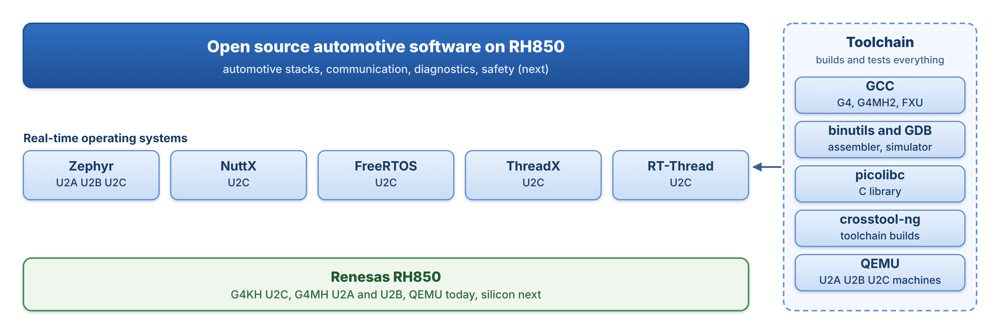

Open source software for Renesas RH850 automotive microcontrollers.

| Area | Repositories |
|------|--------------|
| RTOS | [zephyr](https://github.com/open-rh850/zephyr), [nuttx](https://github.com/open-rh850/nuttx), [freertos ports](https://github.com/open-rh850/freertos-kernel-community-supported-ports), [freertos demos](https://github.com/open-rh850/freertos-community-supported-demos), [threadx](https://github.com/open-rh850/threadx), [rt-thread](https://github.com/open-rh850/rt-thread) |
| Toolchain | [gcc](https://github.com/open-rh850/gcc), [binutils-gdb](https://github.com/open-rh850/binutils-gdb), [picolibc](https://github.com/open-rh850/picolibc), [picolibc-ci-tools](https://github.com/open-rh850/picolibc-ci-tools), [crosstool-ng](https://github.com/open-rh850/crosstool-ng), [qemu](https://github.com/open-rh850/qemu) |
| Releases | [rh850-gcc-toolchain](https://github.com/linumiz/rh850-gcc-toolchain/releases): prebuilt toolchain and QEMU |

Branch `rh850` in each repository is the latest state. All work goes upstream first.

Maintained by [Linumiz](https://linumiz.com). Not affiliated with Renesas Electronics. RH850 is a trademark of Renesas Electronics.
